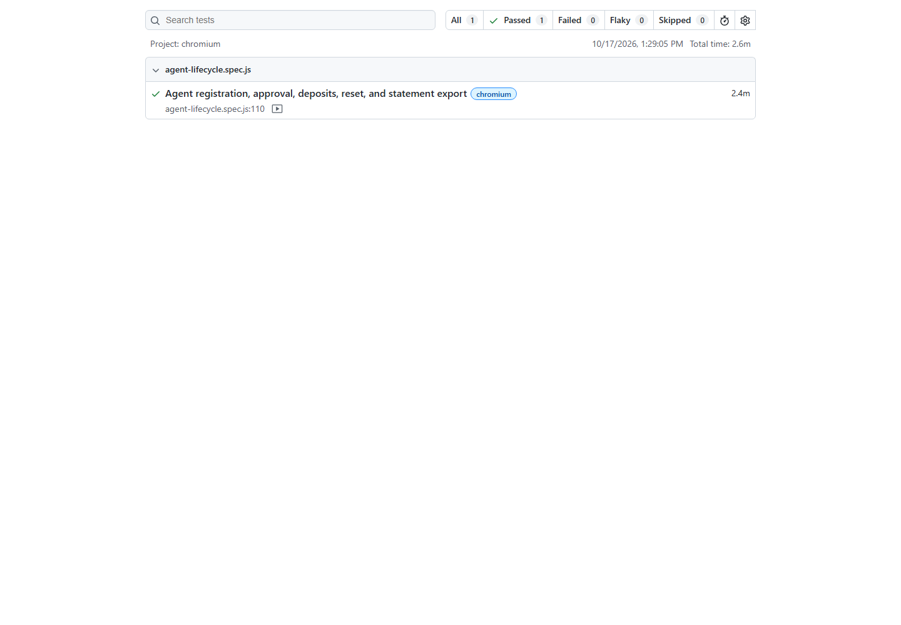
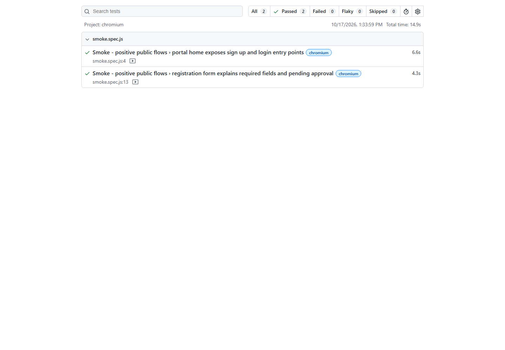

# Batch 19 — Playwright dMoney Assignment

Playwright end-to-end automation for the dMoney training portal: <https://dmoneyportal.roadtocareer.net>.

## Requirements

- Node.js 20+
- npm dependencies (`npm ci`)
- Playwright Chromium (`npx playwright install chromium`)
- A Gmail inbox you can access for Agent OTP and password-reset email
- Admin and System credentials for the training portal
- An existing Customer's **11-digit phone number**, including its leading zero

Copy `.env.example` to `.env` and fill in the local values. Never commit `.env`, OTPs, or credentials.

## Run

```powershell
npm ci
npx playwright install chromium
npm run test:smoke
$env:PW_HEADED='1'; npm run test:regression
```

The regression is intentionally headed because the portal requires live email verification:

1. When Agent login requests an OTP, enter it in the browser and submit it. The test also accepts a fresh `DMONEY_OTP` saved in `.env`.
2. During password reset, copy the reset URL from the Agent email and paste it into `DMONEY_AGENT_RESET_URL` in `.env` as soon as prompted. The test waits up to 15 minutes, validates and opens that link, enters a generated new password, then verifies the old password is rejected and the new one works. The reset URL is a one-time secret; do not share or commit it.

The full regression registers and activates an Agent, checks the initial pending state and persisted active state, funds the Agent with System Cash In, checks the balance, funds an existing Customer, verifies the resulting balance and statement transaction records, resets the Agent password, and exports all visible Self Statement table data to `output/self_statement_YYYY-MM-DD.csv` using the Asia/Dhaka date.

## Test coverage

- `tests/agent-lifecycle.spec.js` — serial, stateful end-to-end regression for the assignment workflow.
- `tests/smoke.spec.js` — positive smoke checks for the public home page and registration form.
- `utils/csv-helper.js` — CSV escaping, UTF-8 output, and date-based file naming.

Run the headed regression with `$env:PW_HEADED='1'; npm run test:regression`, or the positive smoke group with `npm run test:smoke`. Playwright writes videos, traces, screenshots on failure, and HTML reports under `test-results/` and `playwright-report/`; these generated folders and `output/` are ignored by Git.

## Evidence

Latest verification: the headed regression passed, and the smoke suite passed 2/2 tests.

### Regression Test Result



### Smoke Test Result



### Full headed execution

The full headed recording is kept locally and excluded from the public repository because it contains Customer transaction details. Replace it with a redacted copy before publishing video evidence.

## Submission

Initialize a Git repository, review the staged files to ensure no credentials or generated runtime artifacts are included, push it to GitHub, and submit the repository URL.
